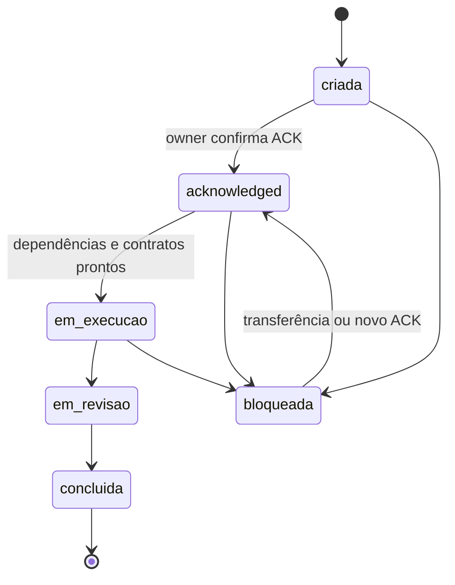

# Fluxos importantes

## Roteamento por tipo de mudança

| Mudança observada | Papel primário | Apoios prováveis |
| --- | --- | --- |
| Correção local ou refatoração | developer | reviewer, qa |
| Tela, navegação ou design system | frontend | qa, reviewer |
| Endpoint, domínio ou integração | backend | security, qa, data |
| Esquema, migração ou consulta | data | backend, qa |
| Limite de módulo ou mudança incompatível | architect | backend/frontend/data, reviewer |
| Login, autorização ou dados sensíveis | security | backend, reviewer, qa |
| Pipeline, ambiente ou release | devops | developer, qa |

O orquestrador deve usar essa tabela como orientação, não como checklist fixo: só delega quando o ganho de especialização ou de paralelismo justifica a coordenação extra.

## Exemplo: feature full-stack

```mermaid
sequenceDiagram
    participant O as Orquestrador
    participant A as Arquitetura
    participant B as Backend
    participant F as Frontend
    participant Q as QA
    participant M as Memória

    O->>O: Recupera contexto e define critérios
    O->>A: Pede decisão ou contrato quando há fronteira nova
    A-->>O: Retorna contrato e riscos
    O->>B: Reserva serviço e propõe contrato
    O->>F: Reserva UI; aguarda aceite do contrato
    B-->>F: Contrato versionado aceito
    B-->>O: Implementação e evidência
    F-->>O: Implementação e evidência
    O->>Q: Pede validação integrada
    Q-->>O: Resultado e regressões
    O->>M: Registra decisão, ações comprovadas e checkpoint
```

## Estado de uma subtarefa persistida



Os detalhes ficam em `.work/tasks/<id>.json`. Uma transferência invalida o ACK anterior; um segundo escritor não pode assumir um caminho sem a transferência explícita.
