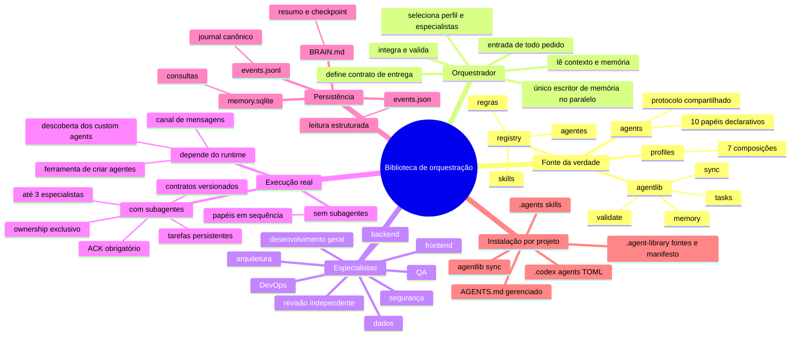
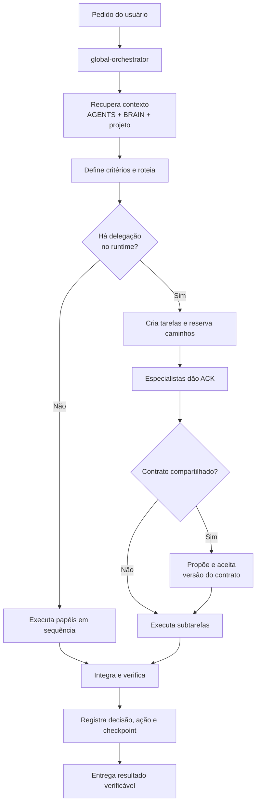

# Mapa mental — orquestrador e agentes

## Legenda operacional

Os losangos são controles reais do protocolo: não são apenas recomendações. Sem ferramenta de delegação, nenhuma subtarefa deve ser apresentada como trabalho paralelo. Sem ACK, ownership válido e contratos aceitos quando necessários, a tarefa não deve avançar para execução dependente.
